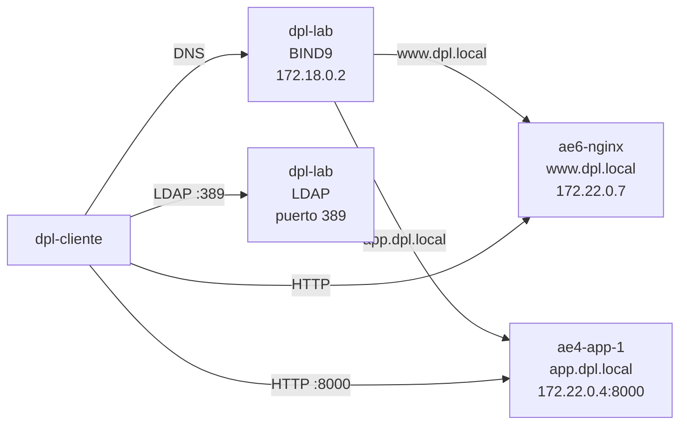

# AE6 — DNS y servicio de directorio

En esta actividad estoy montando un servidor DNS con BIND9 y un servicio de directorio LDAP con OpenLDAP.

La idea es que `dpl-cliente` pueda acceder a los servicios usando nombres como `www.dpl.local` y `app.dpl.local`, y después hacer que la aplicación pueda usar los usuarios guardados en LDAP para iniciar sesión.

## 1. Entorno

Los contenedores que estoy usando son:

- `dpl-lab`: servidor DNS y LDAP.
- `dpl-cliente`: cliente desde el que hago las pruebas.
- `ae6-nginx`: servidor Web nginx.
- `ae4-app-1`: servidor de aplicaciones.

Las IP que tengo ahora mismo son:

| Contenedor | IP |
|---|---|
| `dpl-lab` en `dpl-net` | `172.18.0.2` |
| `dpl-lab` en `ae4_default` | `172.22.0.6` |
| `ae6-nginx` | `172.22.0.7` |
| `ae4-app-1` | `172.22.0.4` |

Estas IP pueden cambiar si se vuelven a crear los contenedores.

## 2. Esquema del entorno



## 3. Preparación de las redes

La aplicación de la AE4 usa la red:

```text
ae4_default
```

Conecté `dpl-cliente` a esa red para que pudiera llegar a nginx y a la aplicación:

```bash
sudo docker network connect ae4_default dpl-cliente
```

También conecté `dpl-lab`:

```bash
sudo docker network connect ae4_default dpl-lab
```

Esto lo necesitaré también para que la aplicación pueda comunicarse con LDAP.

### Problema con nginx

El contenedor `ae4-nginx-1` no arrancaba porque intentaba usar el puerto `8000` del equipo y ese puerto ya estaba ocupado por `dpl-lab`.

Como no quería cambiar la configuración de la AE4, levanté otro nginx sin publicar el puerto en el anfitrión:

```bash
cd ~/dpl/ae4

sudo docker compose run -d --no-deps \
--name ae6-nginx nginx
```

Este nginx quedó funcionando en:

```text
172.22.0.7:80
```

---

# DNS

## 4. Instalación de BIND9

Instalé BIND9 dentro de `dpl-lab`:

```bash
docker exec dpl-lab bash -c \
"apt-get update && apt-get install -y bind9"
```

La versión instalada es:

```text
BIND 9.18.39-0ubuntu0.24.04.9-Ubuntu
```

Como el contenedor no usa `systemd`, tuve que arrancarlo manualmente:

```bash
sudo docker exec -d dpl-lab named -g
```

## 5. Zona `dpl.local`

Creé el fichero:

```text
dns/dpl.local.db
```

con este contenido:

```text
$TTL 3600
$ORIGIN dpl.local.
@       IN  SOA ns1.dpl.local. admin.dpl.local. (
        2026111601 ; serial
        3600       ; refresh
        900        ; retry
        604800     ; expire
        86400 )    ; minimum TTL

@       IN  NS  ns1.dpl.local.
ns1     IN  A   172.18.0.2
www     IN  A   172.22.0.7
app     IN  A   172.22.0.4
```

Con esto:

- `ns1.dpl.local` apunta a `dpl-lab`.
- `www.dpl.local` apunta a nginx.
- `app.dpl.local` apunta a la aplicación.

También configuré `dns/named.conf.local`:

```text
zone "dpl.local" {
    type master;
    file "/etc/bind/db.dpl.local";
};
```

Después copié los archivos a `/etc/bind`:

```bash
sudo docker exec dpl-lab cp \
/home/alumno/dpl/ae6/dns/dpl.local.db \
/etc/bind/db.dpl.local

sudo docker exec dpl-lab cp \
/home/alumno/dpl/ae6/dns/named.conf.local \
/etc/bind/named.conf.local
```

## 6. Comprobación de la zona

Comprobé primero la configuración:

```bash
sudo docker exec dpl-lab named-checkconf
```

No salió ningún error.

Después comprobé la zona:

```bash
sudo docker exec dpl-lab \
named-checkzone dpl.local /etc/bind/db.dpl.local
```

Resultado:

```text
zone dpl.local/IN: loaded serial 2026111601
OK
```

También comprobé que `named` estaba funcionando y que estaba escuchando en el puerto 53.

## 7. Configuración de `dpl-cliente`

Instalé las herramientas necesarias:

```bash
apt-get update
apt-get install -y dnsutils iputils-ping
```

El `/etc/resolv.conf` quedó así:

```text
nameserver 172.18.0.2
nameserver 1.1.1.1
search dpl.local
```

El DNS principal es `dpl-lab`.

También comprobé que no había añadido los nombres a `/etc/hosts`:

```text
sin entradas locales (correcto)
```

## 8. Pruebas de DNS

Probé:

```bash
nslookup www.dpl.local
```

Resultado:

```text
Server:         172.18.0.2
Address:        172.18.0.2#53

Name:   www.dpl.local
Address: 172.22.0.7
```

También comprobé `app.dpl.local`:

```text
Name:   app.dpl.local
Address: 172.22.0.4
```

Con `dig`:

```bash
dig @172.18.0.2 app.dpl.local A +noall +answer
```

Resultado:

```text
app.dpl.local. 3600 IN A 172.22.0.4
```

Con `host`:

```text
www.dpl.local has address 172.22.0.7
dpl.local name server ns1.dpl.local.
```

También hice ping a `www.dpl.local`:

```text
3 packets transmitted, 3 received, 0% packet loss
```

## 9. Acceso por nombre

Probé nginx:

```bash
curl -I http://www.dpl.local
```

Resultado:

```text
HTTP/1.1 200 OK
Server: nginx/1.27.5
Content-Type: text/html; charset=utf-8
```

Después probé la aplicación:

```bash
curl -s http://app.dpl.local:8000/api/mensaje
```

La aplicación respondió correctamente con su JSON.

Con esto ya puedo acceder tanto a nginx como a la aplicación usando nombres DNS y sin usar `/etc/hosts`.

---

# LDAP

## 10. Instalación de OpenLDAP

Instalé `slapd` y `ldap-utils` dentro de `dpl-lab`.

La configuración usada fue:

```text
Dominio: dpl.local
Organización: DPL
Backend: MDB
Contraseña de laboratorio: CAMBIAR_ESTO
```

La versión instalada es OpenLDAP `2.6.10`.

Como tampoco hay `systemd`, lo arranqué manualmente:

```bash
sudo docker exec -d dpl-lab \
slapd -d 0 -h ldap:///
```

Comprobé el proceso:

```text
898 slapd -d 0 -h ldap:///
```

También comprobé que estaba escuchando en el puerto 389.

```text
0.0.0.0:389
[::]:389
```

## 11. Comprobación de la base LDAP

Primero comprobé la base desde `dpl-lab`:

```bash
ldapsearch -x -LLL \
-b "dc=dpl,dc=local" \
"objectClass=*" dn
```

Resultado:

```text
dn: dc=dpl,dc=local
```

Después instalé `ldap-utils` en `dpl-cliente` y repetí la prueba por red:

```bash
sudo docker exec dpl-cliente ldapsearch -x -LLL \
-H ldap://172.18.0.2 \
-b "dc=dpl,dc=local" \
"objectClass=*" dn
```

Resultado:

```text
dn: dc=dpl,dc=local
```

Con esto comprobé que `dpl-cliente` llega al servidor LDAP.

## 12. Usuarios LDAP

Creé el fichero:

```text
ldif/usuarios.ldif
```

Contenido:

```text
dn: ou=usuarios,dc=dpl,dc=local
objectClass: organizationalUnit
ou: usuarios

dn: uid=alumno,ou=usuarios,dc=dpl,dc=local
objectClass: inetOrgPerson
uid: alumno
cn: alumno
sn: Alumno DPL
mail: alumno@dpl.local
userPassword: CAMBIAR_ESTO

dn: uid=maria,ou=usuarios,dc=dpl,dc=local
objectClass: inetOrgPerson
uid: maria
cn: maria
sn: Maria DPL
mail: maria@dpl.local
userPassword: CAMBIAR_ESTO
```

Después lo copié a `dpl-cliente` y lo cargué con `ldapadd`.

Resultado:

```text
adding new entry "ou=usuarios,dc=dpl,dc=local"

adding new entry "uid=alumno,ou=usuarios,dc=dpl,dc=local"

adding new entry "uid=maria,ou=usuarios,dc=dpl,dc=local"
```

## 13. Prueba de usuario y contraseña

Probé el usuario `alumno` con la contraseña correcta:

```bash
ldapwhoami -x \
-H ldap://172.18.0.2 \
-D "uid=alumno,ou=usuarios,dc=dpl,dc=local" \
-W
```

Resultado:

```text
dn:uid=alumno,ou=usuarios,dc=dpl,dc=local
```

Después hice la misma prueba con una contraseña incorrecta.

Resultado:

```text
ldap_bind: Invalid credentials (49)
```

Por tanto, el usuario correcto entra y una contraseña incorrecta es rechazada.

## 14. Búsqueda del usuario

También comprobé los datos del usuario `alumno`:

```bash
ldapsearch -x -LLL \
-H ldap://172.18.0.2 \
-b "ou=usuarios,dc=dpl,dc=local" \
"(uid=alumno)" cn mail
```

Resultado:

```text
dn: uid=alumno,ou=usuarios,dc=dpl,dc=local
cn: alumno
mail: alumno@dpl.local
```

## 15. `slapcat`

Por último hice:

```bash
sudo docker exec dpl-lab slapcat
```

Y pude comprobar que estaban creadas estas entradas:

```text
dn: dc=dpl,dc=local

dn: ou=usuarios,dc=dpl,dc=local

dn: uid=alumno,ou=usuarios,dc=dpl,dc=local

dn: uid=maria,ou=usuarios,dc=dpl,dc=local
```

Las salidas completas de las pruebas las estoy guardando en:

```text
comprobaciones.txt
```

---

# 16. Git

Hasta ahora el historial es:

```text
7c47646 Completo las comprobaciones LDAP
e9d3d24 Añado los usuarios LDAP
8169845 Añado las comprobaciones LDAP
90b6b65 Añado las comprobaciones DNS
0177462 Configuro la zona DNS
cdb7cf5 Creo la extructura
```

He ido haciendo commits según he ido completando cada parte.

---

# 17. Lo que tengo hecho

Hasta ahora tengo funcionando:

- DNS con BIND9.
- Zona `dpl.local`.
- `www.dpl.local`.
- `app.dpl.local`.
- Resolución desde `dpl-cliente`.
- Acceso a nginx por nombre.
- Acceso a la aplicación por nombre.
- LDAP con OpenLDAP.
- Base `dc=dpl,dc=local`.
- Unidad `ou=usuarios`.
- Usuarios `alumno` y `maria`.
- Login LDAP correcto con `ldapwhoami`.
- Error 49 al usar una contraseña incorrecta.
- Búsqueda de usuarios con `ldapsearch`.
- Comprobación del directorio con `slapcat`.

Todavía me falta:

- Integrar la aplicación con LDAP.
- Probar `/api/login`.
- Crear `scripts/comprobar.sh`.
- Hacer los cinco fallos de diagnóstico.
- Subir el proyecto al repositorio remoto.
- Preparar el ZIP final con `.git`.

# 18. Integración de la aplicación con LDAP

La aplicación de la AE4 ya tenía preparado el endpoint:

```text
/api/login
```

y utiliza estas variables para conectarse con LDAP:

```text
LDAP_HOST
LDAP_BASE_DN
LDAP_USER_FILTER
```

Primero comprobé que el contenedor de la aplicación podía encontrar a `dpl-lab` por su nombre dentro de la red `ae4_default`:

```bash
sudo docker exec ae4-app-1 getent hosts dpl-lab
```

Resultado:

```text
172.22.0.6      dpl-lab
```

Por eso pude usar directamente `dpl-lab` en vez de poner una IP fija.

Añadí estas variables en la parte `app` del `compose.yml`:

```yaml
LDAP_HOST: "ldap://dpl-lab"
LDAP_BASE_DN: "ou=usuarios,dc=dpl,dc=local"
LDAP_USER_FILTER: "(uid=%s)"
```

Después reconstruí el contenedor de la aplicación:

```bash
sudo docker compose up -d --build app
```

Comprobé que las variables estaban dentro del contenedor:

```bash
sudo docker exec ae4-app-1 env | grep '^LDAP_'
```

Resultado:

```text
LDAP_BASE_DN=ou=usuarios,dc=dpl,dc=local
LDAP_HOST=ldap://dpl-lab
LDAP_USER_FILTER=(uid=%s)
```

Después probé el login desde `dpl-cliente`, entrando por `www.dpl.local`:

```bash
sudo docker exec dpl-cliente curl -s -X POST \
-d "usuario=alumno&password=CAMBIAR_ESTO" \
http://www.dpl.local/api/login
```

Resultado:

```json
{"autenticado": true, "usuario": "alumno", "perfil": {"cn": "alumno", "mail": "alumno@dpl.local"}}
```

También comprobé el código HTTP y devolvió:

```text
HTTP 200
```

Después repetí la prueba con una contraseña incorrecta:

```bash
sudo docker exec dpl-cliente curl -s -o /dev/null -w 'HTTP %{http_code}\n' -X POST \
-d "usuario=alumno&password=incorrecta" \
http://www.dpl.local/api/login
```

Resultado:

```text
HTTP 401
```

Con esto queda comprobado que la aplicación autentica contra LDAP: acepta las credenciales correctas y rechaza las incorrectas.

La cadena completa que está funcionando ahora mismo es:

```text
dpl-cliente -> DNS -> nginx -> aplicación -> LDAP
```
